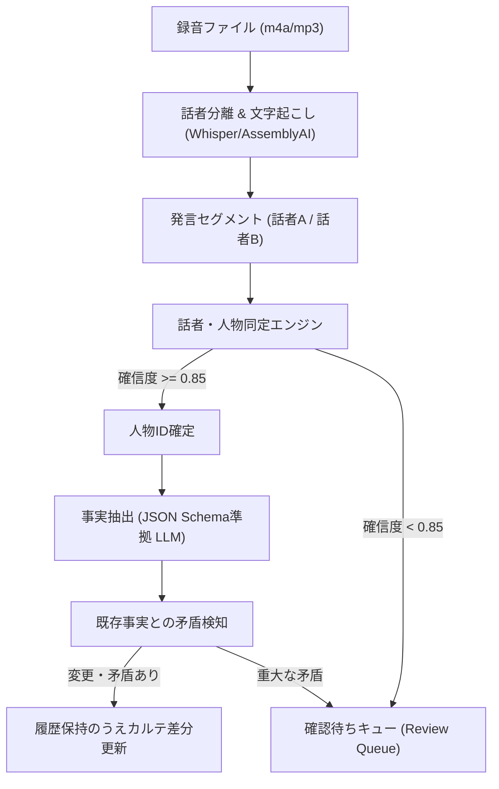

# AI人脈コンシェルジュ — AIパイプライン・抽出仕様書

文書版: v1.0  
基準日: 2026-11-08  
正本準拠: `docs/MASTER_SPEC.md` / `AGENTS.md` / `docs/ACCEPTANCE_TESTS.md`

---

## 1. パイプライン全体フロー



---

## 2. 各ステージのJSON Schema仕様

### ① 名刺OCR（Verbatim Only: 勝手な創作・補完禁止）
```json
{
  "$schema": "http://json-schema.org/draft-07/schema#",
  "title": "BusinessCardExtraction",
  "type": "object",
  "properties": {
    "person_name": { "type": ["string", "null"] },
    "phonetic_name": { "type": ["string", "null"] },
    "company_name": { "type": ["string", "null"] },
    "department": { "type": ["string", "null"] },
    "title": { "type": ["string", "null"] },
    "phone_numbers": { "type": "array", "items": { "type": "string" } },
    "email": { "type": ["string", "null"] },
    "postal_code": { "type": ["string", "null"] },
    "address": { "type": ["string", "null"] },
    "website_url": { "type": ["string", "null"] },
    "ambiguous_fields": {
      "type": "array",
      "items": {
        "type": "object",
        "properties": {
          "field_name": { "type": "string" },
          "raw_detected_text": { "type": "string" },
          "confidence": { "type": "number" },
          "reason": { "type": "string" }
        },
        "required": ["field_name", "raw_detected_text", "confidence"]
      }
    }
  },
  "required": ["person_name", "company_name", "ambiguous_fields"]
}
```

---

### ② 会話分析・事実抽出（Facts Extraction）
```json
{
  "$schema": "http://json-schema.org/draft-07/schema#",
  "title": "MeetingAnalysisExtraction",
  "type": "object",
  "properties": {
    "meeting_summary": { "type": "string" },
    "topics_discussed": {
      "type": "array",
      "items": {
        "type": "object",
        "properties": {
          "topic": { "type": "string" },
          "evidence_quote": { "type": "string" },
          "speaker_label": { "type": "string" }
        },
        "required": ["topic", "evidence_quote", "speaker_label"]
      }
    },
    "promises_made": {
      "type": "array",
      "items": {
        "type": "object",
        "properties": {
          "promiser_label": { "type": "string" },
          "promisee_label": { "type": "string" },
          "action_item": { "type": "string" },
          "due_date": { "type": ["string", "null"] },
          "evidence_quote": { "type": "string" }
        },
        "required": ["promiser_label", "action_item", "evidence_quote"]
      }
    },
    "referral_needs_expressed": {
      "type": "array",
      "items": {
        "type": "object",
        "properties": {
          "speaker_label": { "type": "string" },
          "target_industry_or_client": { "type": "string" },
          "target_area": { "type": ["string", "null"] },
          "evidence_quote": { "type": "string" },
          "visibility": { "type": "string", "enum": ["private", "referral_eligible"] }
        },
        "required": ["speaker_label", "target_industry_or_client", "evidence_quote", "visibility"]
      }
    },
    "business_updates": {
      "type": "array",
      "items": {
        "type": "object",
        "properties": {
          "speaker_label": { "type": "string" },
          "company_or_service": { "type": "string" },
          "update_type": { "type": "string", "enum": ["new_business", "chapter_transfer", "role_change", "address_change"] },
          "detail": { "type": "string" },
          "evidence_quote": { "type": "string" }
        },
        "required": ["speaker_label", "update_type", "detail", "evidence_quote"]
      }
    }
  },
  "required": ["meeting_summary", "topics_discussed", "promises_made", "referral_needs_expressed"]
}
```

---

## 3. 説明可能な紹介レコメンド（Explainable Recommendations）

### レコメンドロジックの多軸評価
紹介候補の算出にあたり、ブラックボックスな「AI類似度スコア」だけを表示することは禁止します。
必ず以下の構成要素を分解して提示します:
1. **地域整合性 (Area Match)**: 紹介先が求める施工/活動地域と、候補者の対応エリアが一致しているか。
2. **事業・専門分野 (Specialty Match)**: 候補者の `business_offerings.specialties` と、紹介先の `referral_needs` が整合しているか。
3. **公開許諾の確認 (Privacy Filter)**: 候補者が `referral_eligible` とした情報のみを使用しているか（`private` 情報の漏洩遮断）。
4. **過去の紹介実績・成約情報 (Track Record)**: 過去にトラブルや辞退がないか。
