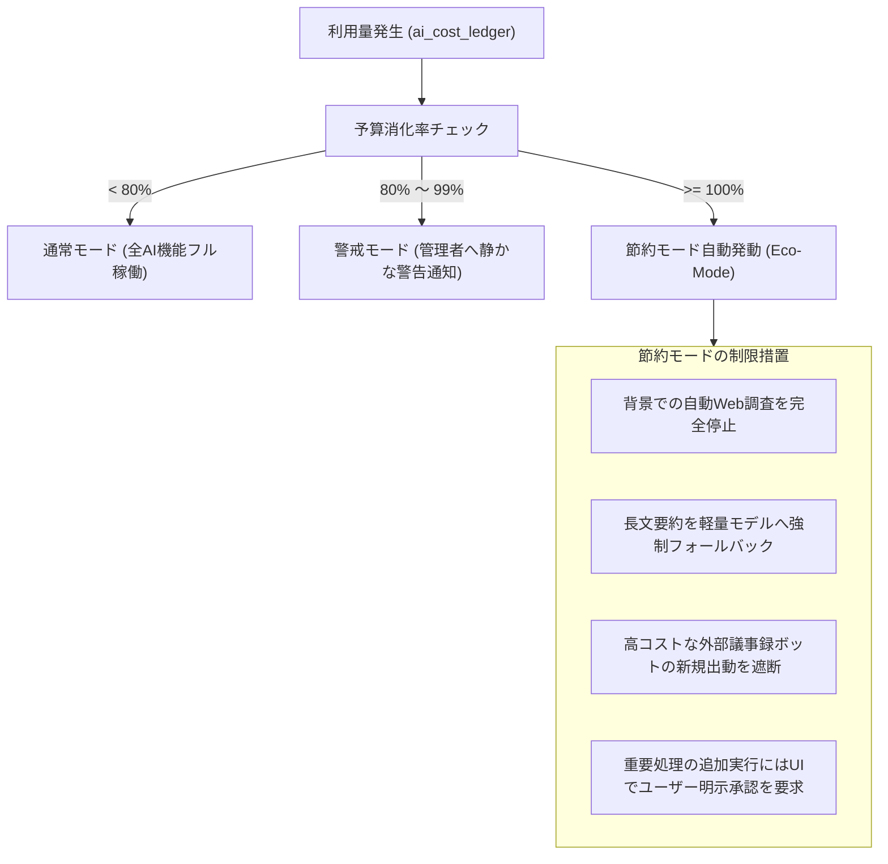

# AI人脈コンシェルジュ — 原価計算・予算ガードレール仕様書

文書版: v1.0  
基準日: 2026-11-08  
正本準拠: `docs/MASTER_SPEC.md` / `docs/PENDING_AND_COSTS.md`

---

## 1. 原価算定モデル（変動費計算式）

特定のAPI業者の固定価格に依存せず、各単価変数を動的に設定可能な計算モデルを採用します。

$$\text{月間直接変動費} = \sum (U_{\text{category}} \times P_{\text{category}})$$

- $U_{\text{bot}}$: 外部議事録ボット稼働時間（分）
- $U_{\text{whisper}}$: 音声文字起こし稼働時間（分）
- $U_{\text{llm\_in}}, U_{\text{llm\_out}}$: LLM 入力/出力トークン数
- $U_{\text{ocr}}$: 名刺画像解析ページ数
- $U_{\text{web}}$: 公開Web調査・企業検索回数
- $U_{\text{storage}}$: 音声・画像ストレージ保持容量（GB・月）

---

## 2. 月間30時間 vs 60時間のシミュレーション試算

| 項目 | 想定単価 (参考標準レート) | 月30回 (各60分 = 30時間) | 月60回 (各60分 = 60時間) |
|---|---|---|---|
| **文字起こし** (Whisper API相当) | 約 ¥0.9 / 分 | 30h × 60m × ¥0.9 = ¥1,620 | 60h × 60m × ¥0.9 = ¥3,240 |
| **LLM会話解析** (要約/事実抽出/差分更新) | 約 ¥15 / 会議 | 30回 × ¥15 = ¥450 | 60回 × ¥15 = ¥900 |
| **名刺OCR** (月間新規20枚〜40枚) | 約 ¥2.5 / 枚 | 20枚 × ¥2.5 = ¥50 | 40枚 × ¥2.5 = ¥100 |
| **Web企業調査** (新規会社のみ月10件) | 約 ¥5 / 件 | 10件 × ¥5 = ¥50 | 20件 × ¥5 = ¥100 |
| **ストレージ** (90日破棄前提・約15GB) | 約 ¥3.5 / GB | 15GB × ¥3.5 = ¥53 | 30GB × ¥3.5 = ¥105 |
| **合計直接変動費 (自ホスト時)** | — | **約 ¥2,223 / 月** | **約 ¥4,445 / 月** |

> **重要注意事項**:
> - 相手主催Zoomで外部有料ボット（例: 1時間約$0.50〜$1.00）を多用した場合、ボット代だけで月¥2,500〜¥5,000が上乗せされます。
> - したがって、**自分用運用の理想（月3,000円）および許容上限（月4,980円）**を守るためには、相手ホスト時の手動録音取込や自ホストZoomの活用が重要となります。

---

## 3. 予算ガードレールと「節約モード（Eco-Mode）」

システムはテナントごとに `monthly_budget_jpy`（初期値: ¥4,980）を保持し、以下のフェイルセーフを自動稼働させます。

