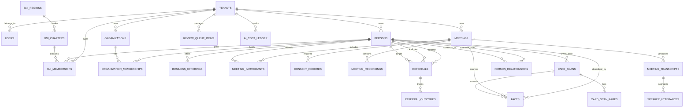

# AI人脈コンシェルジュ — データベース設計・ERD（正本準拠）

文書版: v1.0  
基準日: 2026-11-08  
DB基盤: PostgreSQL 16+ (Supabase) + pgvector + Row Level Security (RLS)

---

## 1. 概念ER図 (Mermaid)

---

## 2. テーブル定義とRLS設計方針

### 全テーブル共通セキュリティ原則
1. **テナント完全分離**: すべてのテーブルに `tenant_id UUID NOT NULL` を保持（マスター系もテナント別またはシステム共有スキーマ）。
2. **RLSポリシー**: `USING (tenant_id = auth.jwt() ->> 'tenant_id')` または `tenant_id IN (SELECT tenant_id FROM user_tenant_memberships WHERE user_id = auth.uid())` を強制。
3. **論理削除とハード削除**: 通常操作は `deleted_at` による論理削除。本人の削除請求（U09）時は関連レコードの物理削除または不可逆匿名化を実施。

---

### テーブル一覧と主キー・外部キー

#### ① テナント・認証・アクセス制御
- **`tenants`**
  - `id`: UUID (PK)
  - `name`: TEXT NOT NULL
  - `plan_tier`: TEXT NOT NULL DEFAULT 'standard'
  - `monthly_budget_jpy`: NUMERIC NOT NULL DEFAULT 4980
  - `current_spend_jpy`: NUMERIC NOT NULL DEFAULT 0
  - `is_budget_throttled`: BOOLEAN NOT NULL DEFAULT FALSE
  - `created_at`: TIMESTAMPTZ NOT NULL DEFAULT NOW()
- **`users`**
  - `id`: UUID (PK, Supabase auth.users 参照)
  - `email`: TEXT NOT NULL UNIQUE
  - `display_name`: TEXT NOT NULL
  - `avatar_url`: TEXT
  - `created_at`: TIMESTAMPTZ NOT NULL DEFAULT NOW()
- **`user_tenant_memberships`**
  - `id`: UUID (PK)
  - `user_id`: UUID NOT NULL REFERENCES `users`(id) ON DELETE CASCADE
  - `tenant_id`: UUID NOT NULL REFERENCES `tenants`(id) ON DELETE CASCADE
  - `role`: TEXT NOT NULL DEFAULT 'owner' CHECK (role IN ('owner', 'admin', 'member'))
  - `created_at`: TIMESTAMPTZ NOT NULL DEFAULT NOW()
  - UNIQUE(`user_id`, `tenant_id`)

#### ② 人物・会社・事業・BNI所属
- **`persons`**
  - `id`: UUID (PK)
  - `tenant_id`: UUID NOT NULL REFERENCES `tenants`(id) ON DELETE CASCADE
  - `display_name`: TEXT NOT NULL
  - `phonetic_name`: TEXT -- ふりがな
  - `status`: TEXT NOT NULL DEFAULT 'active' CHECK (status IN ('active', 'provisional', 'archived', 'deleted')) -- provisionalは仮カルテ
  - `category_tags`: TEXT[] NOT NULL DEFAULT '{}' -- ['BNI', 'Work', 'Friend']
  - `avatar_url`: TEXT
  - `primary_phone`: TEXT
  - `primary_email`: TEXT
  - `office_address`: TEXT
  - `service_areas`: TEXT[] NOT NULL DEFAULT '{}' -- 対応地域
  - `meeting_count`: INTEGER NOT NULL DEFAULT 0
  - `last_interacted_at`: TIMESTAMPTZ
  - `created_at`: TIMESTAMPTZ NOT NULL DEFAULT NOW()
  - `updated_at`: TIMESTAMPTZ NOT NULL DEFAULT NOW()
  - INDEX: `idx_persons_tenant_status` (`tenant_id`, `status`)
  - INDEX: `idx_persons_tenant_name` (`tenant_id`, `display_name`)
- **`organizations`**
  - `id`: UUID (PK)
  - `tenant_id`: UUID NOT NULL REFERENCES `tenants`(id) ON DELETE CASCADE
  - `name`: TEXT NOT NULL
  - `corporate_number`: TEXT
  - `website_url`: TEXT
  - `headquarters_address`: TEXT
  - `summary`: TEXT
  - `created_at`: TIMESTAMPTZ NOT NULL DEFAULT NOW()
- **`organization_memberships`**
  - `id`: UUID (PK)
  - `tenant_id`: UUID NOT NULL REFERENCES `tenants`(id) ON DELETE CASCADE
  - `person_id`: UUID NOT NULL REFERENCES `persons`(id) ON DELETE CASCADE
  - `organization_id`: UUID NOT NULL REFERENCES `organizations`(id) ON DELETE CASCADE
  - `title`: TEXT NOT NULL -- 役職
  - `department`: TEXT
  - `is_current`: BOOLEAN NOT NULL DEFAULT TRUE
  - `started_on`: DATE
  - `ended_on`: DATE
  - `source_note`: TEXT
  - INDEX: `idx_org_members_person` (`tenant_id`, `person_id`)
- **`business_offerings`**
  - `id`: UUID (PK)
  - `tenant_id`: UUID NOT NULL REFERENCES `tenants`(id) ON DELETE CASCADE
  - `person_id`: UUID NOT NULL REFERENCES `persons`(id) ON DELETE CASCADE
  - `organization_id`: UUID REFERENCES `organizations`(id) ON DELETE SET NULL
  - `service_title`: TEXT NOT NULL -- 例: 「買取再販」「オフィス内装」
  - `target_clients`: TEXT -- 求めたい顧客・紹介ニーズ
  - `specialties`: TEXT -- 強み・得意分野
  - `service_area`: TEXT
  - `is_active`: BOOLEAN NOT NULL DEFAULT TRUE
  - INDEX: `idx_business_offerings_person` (`tenant_id`, `person_id`)
- **`bni_regions`**
  - `id`: UUID (PK)
  - `prefecture`: TEXT NOT NULL -- 都道府県 (多対多/複数県カバー考慮)
  - `region_code`: TEXT NOT NULL UNIQUE
  - `region_name`: TEXT NOT NULL -- 例: 京都リージョン, 阪神南リージョン
  - `is_active`: BOOLEAN NOT NULL DEFAULT TRUE
- **`bni_chapters`**
  - `id`: UUID (PK)
  - `region_id`: UUID NOT NULL REFERENCES `bni_regions`(id) ON DELETE CASCADE
  - `chapter_name`: TEXT NOT NULL
  - `meeting_day`: TEXT -- 例: 水曜
  - `meeting_time`: TEXT -- 例: 06:45〜08:30
  - `is_verified`: BOOLEAN NOT NULL DEFAULT TRUE -- 公開マスター or ユーザー手動追加
  - UNIQUE(`region_id`, `chapter_name`)
- **`bni_memberships`**
  - `id`: UUID (PK)
  - `tenant_id`: UUID NOT NULL REFERENCES `tenants`(id) ON DELETE CASCADE
  - `person_id`: UUID NOT NULL REFERENCES `persons`(id) ON DELETE CASCADE
  - `chapter_id`: UUID NOT NULL REFERENCES `bni_chapters`(id) ON DELETE RESTRICT
  - `category`: TEXT NOT NULL -- BNI専門分野
  - `role_history`: TEXT -- 例: プレジデント, 書記兼会計
  - `status`: TEXT NOT NULL DEFAULT 'active' CHECK (status IN ('active', 'transferred', 'alumni', 'visitor'))
  - `joined_on`: DATE
  - `left_on`: DATE
  - `transfer_reason`: TEXT
  - INDEX: `idx_bni_memberships_chapter` (`tenant_id`, `chapter_id`, `status`)

#### ③ 予定・会議・同意・音声・文字起こし
- **`meetings`**
  - `id`: UUID (PK)
  - `tenant_id`: UUID NOT NULL REFERENCES `tenants`(id) ON DELETE CASCADE
  - `title`: TEXT NOT NULL
  - `meeting_type`: TEXT NOT NULL DEFAULT '1to1' CHECK (meeting_type IN ('1to1', 'business_meeting', 'internal_meeting', 'networking', 'other'))
  - `provider`: TEXT NOT NULL DEFAULT 'zoom' CHECK (provider IN ('zoom', 'google_meet', 'in_person', 'phone', 'other'))
  - `meeting_url`: TEXT
  - `meeting_code`: TEXT -- 重複判定用（Zoom Meeting ID等）
  - `scheduled_start_at`: TIMESTAMPTZ NOT NULL
  - `scheduled_end_at`: TIMESTAMPTZ
  - `raw_invite_text`: TEXT -- 貼り付けられた原文
  - `host_type`: TEXT NOT NULL DEFAULT 'self' CHECK (host_type IN ('self', 'external', 'unknown'))
  - `recording_status`: TEXT NOT NULL DEFAULT 'not_applicable' CHECK (recording_status IN ('not_applicable', 'awaiting_consent', 'consent_obtained', 'recording', 'completed', 'failed', 'refused'))
  - `created_at`: TIMESTAMPTZ NOT NULL DEFAULT NOW()
  - INDEX: `idx_meetings_tenant_time` (`tenant_id`, `scheduled_start_at`)
  - INDEX: `idx_meetings_duplicate_check` (`tenant_id`, `meeting_code`, `scheduled_start_at`)
- **`meeting_participants`**
  - `id`: UUID (PK)
  - `tenant_id`: UUID NOT NULL REFERENCES `tenants`(id) ON DELETE CASCADE
  - `meeting_id`: UUID NOT NULL REFERENCES `meetings`(id) ON DELETE CASCADE
  - `person_id`: UUID REFERENCES `persons`(id) ON DELETE SET NULL -- 未登録時はNULL
  - `raw_name`: TEXT NOT NULL
  - `role`: TEXT NOT NULL DEFAULT 'attendee' CHECK (role IN ('host', 'attendee', 'bot'))
  - UNIQUE(`meeting_id`, `person_id`, `raw_name`)
- **`consent_records`**
  - `id`: UUID (PK)
  - `tenant_id`: UUID NOT NULL REFERENCES `tenants`(id) ON DELETE CASCADE
  - `meeting_id`: UUID NOT NULL REFERENCES `meetings`(id) ON DELETE CASCADE
  - `person_id`: UUID REFERENCES `persons`(id) ON DELETE SET NULL
  - `status`: TEXT NOT NULL CHECK (status IN ('pending', 'granted', 'rejected', 'revoked'))
  - `consent_method`: TEXT NOT NULL CHECK (consent_method IN ('in_person_verbal', 'form_signed', 'zoom_audio_prompt', 'bot_chat_acknowledged', 'manual_override'))
  - `evidence_text`: TEXT
  - `recorded_at`: TIMESTAMPTZ NOT NULL DEFAULT NOW()
  - `revoked_at`: TIMESTAMPTZ
  - INDEX: `idx_consent_meeting` (`tenant_id`, `meeting_id`)
- **`meeting_recordings`**
  - `id`: UUID (PK)
  - `tenant_id`: UUID NOT NULL REFERENCES `tenants`(id) ON DELETE CASCADE
  - `meeting_id`: UUID NOT NULL REFERENCES `meetings`(id) ON DELETE CASCADE
  - `storage_path`: TEXT NOT NULL -- private bucket
  - `duration_seconds`: INTEGER NOT NULL DEFAULT 0
  - `file_size_bytes`: BIGINT NOT NULL DEFAULT 0
  - `expires_at`: TIMESTAMPTZ NOT NULL -- デフォルト90日後
  - `is_pinned_permanently`: BOOLEAN NOT NULL DEFAULT FALSE -- 恒久保持フラグ
  - `is_deleted`: BOOLEAN NOT NULL DEFAULT FALSE
  - `deleted_at`: TIMESTAMPTZ
  - INDEX: `idx_recordings_expiry` (`expires_at`, `is_deleted`)
- **`meeting_transcripts`**
  - `id`: UUID (PK)
  - `tenant_id`: UUID NOT NULL REFERENCES `tenants`(id) ON DELETE CASCADE
  - `meeting_id`: UUID NOT NULL REFERENCES `meetings`(id) ON DELETE CASCADE
  - `language`: TEXT NOT NULL DEFAULT 'ja'
  - `full_text`: TEXT NOT NULL
  - `summary`: TEXT
  - `processing_cost_jpy`: NUMERIC NOT NULL DEFAULT 0
  - `created_at`: TIMESTAMPTZ NOT NULL DEFAULT NOW()
- **`speaker_utterances`**
  - `id`: UUID (PK)
  - `transcript_id`: UUID NOT NULL REFERENCES `meeting_transcripts`(id) ON DELETE CASCADE
  - `speaker_label`: TEXT NOT NULL -- 例: 'SPEAKER_00', '話者A'
  - `resolved_person_id`: UUID REFERENCES `persons`(id) ON DELETE SET NULL
  - `start_seconds`: NUMERIC NOT NULL
  - `end_seconds`: NUMERIC NOT NULL
  - `utterance_text`: TEXT NOT NULL
  - `confidence`: NUMERIC NOT NULL DEFAULT 1.0

#### ④ 事実（Facts）・名刺・レビューキュー
- **`facts`**
  - `id`: UUID (PK)
  - `tenant_id`: UUID NOT NULL REFERENCES `tenants`(id) ON DELETE CASCADE
  - `person_id`: UUID NOT NULL REFERENCES `persons`(id) ON DELETE CASCADE
  - `fact_category`: TEXT NOT NULL CHECK (fact_category IN ('topic', 'promise', 'request', 'background', 'preference', 'conflict'))
  - `fact_key`: TEXT NOT NULL -- 例: 「盛り上がった話題」「約束」「紹介希望先」
  - `fact_value`: TEXT NOT NULL
  - `source_type`: TEXT NOT NULL CHECK (source_type IN ('meeting_speech', 'card_ocr', 'web_research', 'manual_edit'))
  - `source_id`: UUID -- meeting_id, card_scan_id 等
  - `source_utterance_id`: UUID REFERENCES `speaker_utterances`(id) ON DELETE SET NULL
  - `confidence`: NUMERIC NOT NULL DEFAULT 1.0
  - `verification_status`: TEXT NOT NULL DEFAULT 'unverified' CHECK (verification_status IN ('verified', 'reported', 'inferred', 'needs_review', 'disputed', 'obsolete'))
  - `visibility`: TEXT NOT NULL DEFAULT 'private' CHECK (visibility IN ('private', 'referral_eligible', 'public'))
  - `valid_from`: TIMESTAMPTZ NOT NULL DEFAULT NOW()
  - `valid_until`: TIMESTAMPTZ
  - `created_at`: TIMESTAMPTZ NOT NULL DEFAULT NOW()
  - INDEX: `idx_facts_person` (`tenant_id`, `person_id`, `verification_status`)
- **`card_scans`**
  - `id`: UUID (PK)
  - `tenant_id`: UUID NOT NULL REFERENCES `tenants`(id) ON DELETE CASCADE
  - `matched_person_id`: UUID REFERENCES `persons`(id) ON DELETE SET NULL
  - `raw_ocr_payload`: JSONB NOT NULL
  - `status`: TEXT NOT NULL DEFAULT 'completed' CHECK (status IN ('uploaded', 'processing', 'completed', 'needs_review', 'failed'))
  - `created_at`: TIMESTAMPTZ NOT NULL DEFAULT NOW()
- **`card_scan_pages`**
  - `id`: UUID (PK)
  - `card_scan_id`: UUID NOT NULL REFERENCES `card_scans`(id) ON DELETE CASCADE
  - `page_type`: TEXT NOT NULL DEFAULT 'front' CHECK (page_type IN ('front', 'back'))
  - `image_storage_path`: TEXT NOT NULL
- **`review_queue_items`**
  - `id`: UUID (PK)
  - `tenant_id`: UUID NOT NULL REFERENCES `tenants`(id) ON DELETE CASCADE
  - `queue_type`: TEXT NOT NULL CHECK (queue_type IN ('speaker_identification', 'card_ocr_ambiguous', 'person_deduplication', 'conflicting_facts', 'unregistered_person'))
  - `target_id`: UUID NOT NULL -- 対象レコードID
  - `title`: TEXT NOT NULL
  - `description`: TEXT NOT NULL
  - `candidate_payload`: JSONB NOT NULL -- 提案選択肢など
  - `status`: TEXT NOT NULL DEFAULT 'pending' CHECK (status IN ('pending', 'resolved', 'dismissed'))
  - `resolved_at`: TIMESTAMPTZ
  - `created_at`: TIMESTAMPTZ NOT NULL DEFAULT NOW()
  - INDEX: `idx_review_queue_tenant` (`tenant_id`, `status`)

#### ⑤ 人間関係・相関図・紹介
- **`person_relationships`**
  - `id`: UUID (PK)
  - `tenant_id`: UUID NOT NULL REFERENCES `tenants`(id) ON DELETE CASCADE
  - `from_person_id`: UUID NOT NULL REFERENCES `persons`(id) ON DELETE CASCADE
  - `to_person_id`: UUID NOT NULL REFERENCES `persons`(id) ON DELETE CASCADE
  - `relationship_type`: TEXT NOT NULL -- 例: 'coworker', 'chapter_mate', 'client', 'referred_by'
  - `is_ai_inferred`: BOOLEAN NOT NULL DEFAULT FALSE -- 確定関係 vs AI推薦関係
  - `confidence`: NUMERIC NOT NULL DEFAULT 1.0
  - `evidence_text`: TEXT
  - `source_meeting_id`: UUID REFERENCES `meetings`(id) ON DELETE SET NULL
  - `created_at`: TIMESTAMPTZ NOT NULL DEFAULT NOW()
  - INDEX: `idx_relationships_pair` (`tenant_id`, `from_person_id`, `to_person_id`, `is_ai_inferred`)
- **`referrals`**
  - `id`: UUID (PK)
  - `tenant_id`: UUID NOT NULL REFERENCES `tenants`(id) ON DELETE CASCADE
  - `referrer_person_id`: UUID NOT NULL REFERENCES `persons`(id) ON DELETE CASCADE -- 紹介元
  - `candidate_person_id`: UUID NOT NULL REFERENCES `persons`(id) ON DELETE CASCADE -- 紹介される人
  - `target_person_id`: UUID NOT NULL REFERENCES `persons`(id) ON DELETE CASCADE -- 紹介先
  - `recommendation_reason`: TEXT NOT NULL -- 根拠・理由
  - `draft_message`: TEXT -- 紹介文下書き
  - `status`: TEXT NOT NULL DEFAULT 'suggested' CHECK (status IN ('suggested', 'consent_pending', 'sent', 'declined', 'in_progress', 'completed'))
  - `sent_at`: TIMESTAMPTZ
  - `created_at`: TIMESTAMPTZ NOT NULL DEFAULT NOW()
- **`referral_outcomes`**
  - `id`: UUID (PK)
  - `referral_id`: UUID NOT NULL REFERENCES `referrals`(id) ON DELETE CASCADE
  - `outcome_type`: TEXT NOT NULL CHECK (outcome_type IN ('meeting_held', 'contract_won', 'no_deal', 'pending'))
  - `amount_jpy`: NUMERIC
  - `notes`: TEXT
  - `confirmed_by_user`: BOOLEAN NOT NULL DEFAULT FALSE -- 未確認成果の自動確定禁止
  - `updated_at`: TIMESTAMPTZ NOT NULL DEFAULT NOW()

#### ⑥ 原価管理・監査ログ
- **`ai_cost_ledger`**
  - `id`: UUID (PK)
  - `tenant_id`: UUID NOT NULL REFERENCES `tenants`(id) ON DELETE CASCADE
  - `service_category`: TEXT NOT NULL CHECK (service_category IN ('bot_minutes', 'audio_transcribe', 'llm_tokens', 'ocr_pages', 'web_search', 'storage_bytes'))
  - `provider`: TEXT NOT NULL
  - `units_consumed`: NUMERIC NOT NULL
  - `cost_jpy`: NUMERIC NOT NULL
  - `related_job_id`: UUID
  - `created_at`: TIMESTAMPTZ NOT NULL DEFAULT NOW()
  - INDEX: `idx_ai_cost_tenant_time` (`tenant_id`, `created_at`)
- **`audit_logs`**
  - `id`: UUID (PK)
  - `tenant_id`: UUID NOT NULL REFERENCES `tenants`(id) ON DELETE CASCADE
  - `actor_user_id`: UUID REFERENCES `users`(id) ON DELETE SET NULL
  - `action`: TEXT NOT NULL
  - `resource_type`: TEXT NOT NULL
  - `resource_id`: UUID
  - `diff_payload`: JSONB
  - `ip_address`: TEXT
  - `created_at`: TIMESTAMPTZ NOT NULL DEFAULT NOW()
