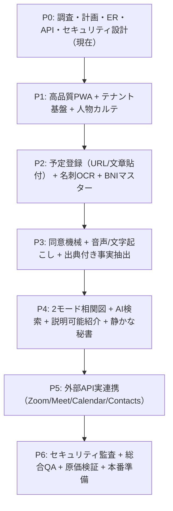

# AI人脈コンシェルジュ — 実装計画書（P0〜P6）

文書版: v1.0  
基準日: 2026-11-08  
正本準拠: `docs/MASTER_SPEC.md` / `AGENTS.md` / `docs/ACCEPTANCE_TESTS.md`

---

## 1. 開発原則と役割分担

本プロジェクトは「人を忘れず、大事にするためのAI人脈コンシェルジュ」を構築するものであり、安易なモック実装や事実の勝手な補完を厳禁とします。

### 担当役割の統合定義
- **プロダクトマネージャー**: BNI 1to1を中心とする実利用体験（月30〜60時間の面談）、北極星指標の担保。
- **セキュリティ・プライバシー責任者**: RLS（行レベルセキュリティ）、テナント境界、同意状態機械、90日音声自動破棄、プロンプトインジェクション防御。
- **アーキテクト / フルスタックエンジニア**: React + Vite + Tailwind (PWA) + FastAPI + PostgreSQL (Supabase) + ジョブキュー。
- **AI/LLMエンジニア**: 出典付き事実抽出、話者分離と人物名寄せの分離、説明可能な紹介レコメンド、コスト防壁。
- **QAエンジニア**: `docs/ACCEPTANCE_TESTS.md` の全項目検証、Playwright E2E、マルチテナント越境テスト。

---

## 2. マイルストーン・フェーズ計画（P0〜P6）

---

### フェーズ詳細仕様

| フェーズ | 主要目標 | 主要作成物・対象テーブル | 主な受け入れ基準 |
|---|---|---|---|
| **P0: 調査・計画・設計** | アーキテクチャ確定、ERD、API仕様、画面設計、同意/セキュリティ仕様の完全文書化 | `docs/*`, `README.md`, `.env.example`, プロジェクト骨格 | 全設計書が正本と無矛盾で揃い、P1着手準備完了 |
| **P1: 高品質PWA + カルテ基盤** | Apple風ミニマルUI、Supabase認証/RLS、マルチテナント境界、人物カルテCRUD、複数事業/役職、BNI所属履歴 | `tenants`, `users`, `persons`, `organizations`, `organization_memberships`, `bni_memberships`, `facts` | 2テナント間完全隔離、移籍履歴保持、手動修正の巻き戻し不可、スマホ/PC表示確認 |
| **P2: 予定・名刺・BNIマスター** | LINE/メール文面からの予定抽出、固定URL判定、名刺両面/複数OCR、BNI全国階層マスター | `meetings`, `meeting_participants`, `card_scans`, `bni_regions`, `bni_chapters`, `review_queue_items` | 重複登録防止、OCRによる勝手な創作禁止（原画対照）、曖昧漢字は確認待ち |
| **P3: 同意・会話解析・事実抽出** | 同意状態機械、音声/テキスト手動取込、話者分離と実名同定の分離、出典付きfacts差分更新、90日破棄 | `consent_records`, `meeting_recordings`, `meeting_transcripts`, `speaker_utterances`, `ai_jobs` | 同意なし録音遮断、話者不明情報のカルテ自動反映禁止、90日保存期限ジョブ動作 |
| **P4: 相関図・AI検索・紹介** | 2モード相関図（実関係 vs AI推薦）、自然言語/音声検索、根拠付き紹介下書き、静かな通知 | `person_relationships`, `referrals`, `referral_outcomes`, `notification_settings` | 根拠なき紹介禁止、非公開情報の紹介除外、無断送信なし、数千件クラスタリング |
| **P5: 外部API実連携** | Zoom/Meet/Google Calendar/Gmail/Contacts の認可別連携とフォールバック | 外部OAuthトークン管理、Webhook受信ハンドラ、外部ボット連携 | 実認可とモックの明確な区別、TimeTree手動扱い、個人LINE自動取得除外 |
| **P6: 監査・総合QA・本番運用** | 全受け入れテスト照合、プロンプトインジェクション試験、月間予算上限/節約モード、障害復旧 | 監査ログテーブル、利用量台帳 (`ai_cost_ledger`)、E2Eテストスイート | 全テストID判定完了、予算超過時自動セーフガード、データ完全削除実証 |

---

## 3. リスク管理と代替案（フォールバック）

1. **Zoom/Meet相手主催会議の録音制約**
   - *リスク*: 相手がホストの会議では、クラウド録画Webhookや録音APIが利用できない。
   - *対策*: 外部ホスト会議ではボット参加（相手の事前承諾必須）または会議後の手動録音/メモ・文字起こしファイル取込へ安全に誘導する。
2. **名刺OCRの誤読・固有名詞欠損**
   - *リスク*: 達筆フォントや低解像度で誤字が発生。
   - *対策*: 原画とOCR結果の並列UIを提供し、低確度フィールドは黄色ハイライトで手動確認を促す。外部Web情報での自動補完は厳禁。
3. **会話からの話者誤同定**
   - *リスク*: 「話者A」が「山田さん」だと推測した結果、別人のカルテに事実が上書きされる。
   - *対策*: 話者分離ラベルと実名リンクを分離テーブルで管理。確信度が閾値未満の場合は「確認待ちキュー」に格納。
4. **月間AIコストの予算超過**
   - *リスク*: 1to1の回数増（月60時間超）により、LLMトークン代や文字起こし代が月額目標を突破。
   - *対策*: `ai_cost_ledger` によるリアルタイム原価集計。予算80%で警告、100%で低優先ジョブ（Web調査や詳細分析）を停止する「節約モード」を自動発動。
