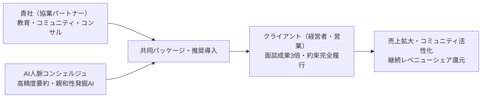
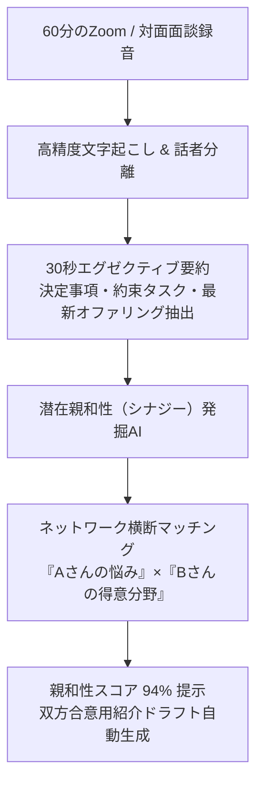
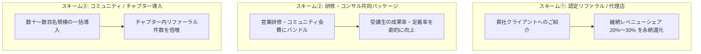
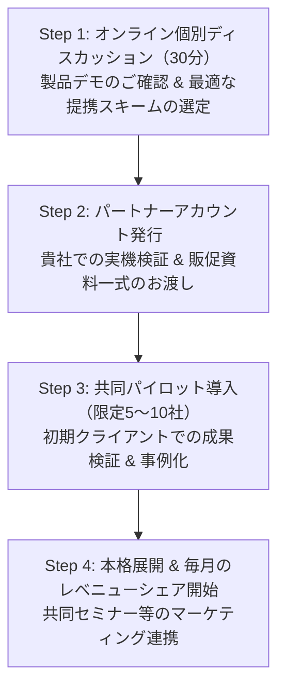

# AI人脈コンシェルジュ 協業・アライアンス提案資料
## — 信頼資本を最大化する次世代エコシステムの共創 —

```
文書番号: PARTNER-PROPOSAL-2026-v1
対象: ビジネスコーチ、営業研修企業、BNIディレクター/アンバサダー、士業・経営者団体、CRM/SaaS販売代理店
製品URL: https://ai-network-concierge.vercel.app
```

---

## 1. エグゼクティブ・サマリー（協業の目的）

> **「人と人とのつながり（人脈）を、最大価値のビジネス成果へ。」**  
> AI人脈コンシェルジュは、1to1や面談の会話を高精度に文字起こし・要約し、ネットワーク内の**潜在的な親和性（ビジネスシナジー）を自動発掘するAI専属秘書SaaS**です。
> 
> 本提案は、貴社の既存顧客（経営者・営業組織・コミュニティ会員）に対し、本システムを共同展開することで、**クライアントの成約・紹介成果を劇的に引き上げながら、継続的なストック収益（レベニューシェア）を共創する**アライアンスのご提案です。



---

## 2. パートナー企業が抱える「3つの課題」と本協業による解決

| 貴社が直面しやすい課題 | 従来の限界 | AI人脈コンシェルジュとの協業による解決 |
|---|---|---|
| **① コンサル・研修後の「実践継続」が難しい** | ノウハウを教えても、受講生の面談メモやフォローアップが属人化して途切れる | **AIが毎回の面談要約・約束事項・紹介状ドラフトを自動生成**するため、受講生が確実に成果を出し続けられる |
| **② コミュニティ内のビジネスマッチングが手動** | 主催者が頭の中だけで会員同士をマッチングしており、規模拡大に伴い限界が来る | **全会員の事業オファリングと会話ニーズをAIが自動解析**し、高確率な親和性（90%+合致）を即座に推薦 |
| **③ 単発コンサルから「ストック収益」への移行** | 毎月のフロー営業に追われ、LTV（顧客生涯価値）が伸び悩む | **月額利用料の継続レベニューシェア**により、安定したストック型収益基盤を構築可能 |

---

## 3. 製品の中核強み: 「文字起こし要約 × 潜在親和性発掘エンジン」

単に音声を文字にするだけの他社ツールとは根本的に異なり、**「ビジネス成約に繋がる親和性」を発掘することに特化**しています。



### 実際の親和性発掘の例:
- **会員Aさん（飲食店オーナー）**: 会話内で「古民家風の和モダンな2号店を出したいが、耐震基準や補助金がよくわからない」と発言。
- **会員Bさん（工務店代表）**: カルテに「京町家・古民家耐震リノベーション、補助金申請サポート実績多数」を保持。
- **AIの自動アクション**: 「親和性94%」を検知し、コンシェルジュが双方への失礼のない紹介状ドラフトを自動作成。**口約束や記憶の埋もれをゼロにし、成約に直結させます。**

---

## 4. 選べる3つのアライアンス・スキーム

貴社のビジネスモデルに合わせて、柔軟な提携形態をご用意しております。



### スキーム詳細比較

| 項目 | ① 認定紹介・代理店 | ② コンサル・研修パッケージ | ③ コミュニティ・チャプター導入 |
|---|---|---|---|
| **対象** | 士業・セールスコーチ・個人事業主 | 営業コンサル企業・人材育成スクール | BNIチャプター、異業種交流会、商工会議所 |
| **提供形態** | 専用紹介リンクまたはクーポン発行 | 貴社プログラムの公式ツールとして同梱 | グループ専用テナントの一括開設 |
| **レベニューシェア** | **月額利用料の20%〜30%を永続還元** | 卸価格（OEM/特別パートナー価格）提供 | ボリュームディスカウント ＋ 管理機能 |
| **貴社工数** | 紹介のみ（サポート・運用は弊社担当） | 貴社カリキュラム内での活用指導 | チャプター全体の相関図・成果可視化 |

---

## 5. 収益シミュレーション（レベニューシェア例）

本製品は解約率の極めて低い「人脈インフラSaaS」のため、紹介件数が積み上がるほど強固な不労ストック収益となります。

```
【条件: 標準プラン 月額4,980円（税込） / レベニューシェア率 25%】
貴社への還元額: 1アカウントあたり 月額 約1,245円（永続）
```

| 累計紹介・導入アカウント数 | 貴社への月間還元額 | 貴社への年間ストック収益 |
|---|---|---|
| **30名**（1チャプター規模） | **¥37,350 / 月** | **¥448,200 / 年** |
| **100名**（顧客・受講生規模） | **¥124,500 / 月** | **¥1,494,000 / 年** |
| **300名**（複数チャプター・法人） | **¥373,500 / 月** | **¥4,482,000 / 年** |

※さらに、ツールの導入によってクライアントの成約率が上がるため、**貴社自身のコンサル契約継続率（リテンション）も大幅に向上**します。

---

## 6. 提携パートナー様への万全のサポート体制

1. **パートナー様向け無償アカウント提供**:
   - 貴社自身が効果を体感し、自社の人脈管理・営業活動にフル活用していただけるアカウントを無償付与。
2. **セールス・販促ツールの完全提供**:
   - 営業提案スライド（全14枚 / PDF）、デモ用動画、クライアント向け案内文テンプレートをすべて無償提供。
3. **共同ウェビナー・勉強会の共催**:
   - 「AI時代のGivers Gain人脈戦略」「1to1の成約率を3倍にする最新AI活用」などの共催セミナーを企画・登壇サポート。
4. **専任オンボーディング支援**:
   - クライアントへの導入時、初期設定（Zoom連携・名刺取込）のカスタマーサポートは弊社が全面バックアップ。

---

## 7. 提携開始までのステップ（最短2週間）



---

## 8. お問い合わせ・協業のお申し込み

- **サービス本番URL**: [https://ai-network-concierge.vercel.app](https://ai-network-concierge.vercel.app)
- **プレゼンスライド**: [https://ai-network-concierge.vercel.app/#/deck](https://ai-network-concierge.vercel.app/#/deck)
- **担当窓口**: AI人脈コンシェルジュ アライアンス推進部
- **お問い合わせ**: 本サービス内設定画面または公式窓口よりお気軽にご連絡ください。
