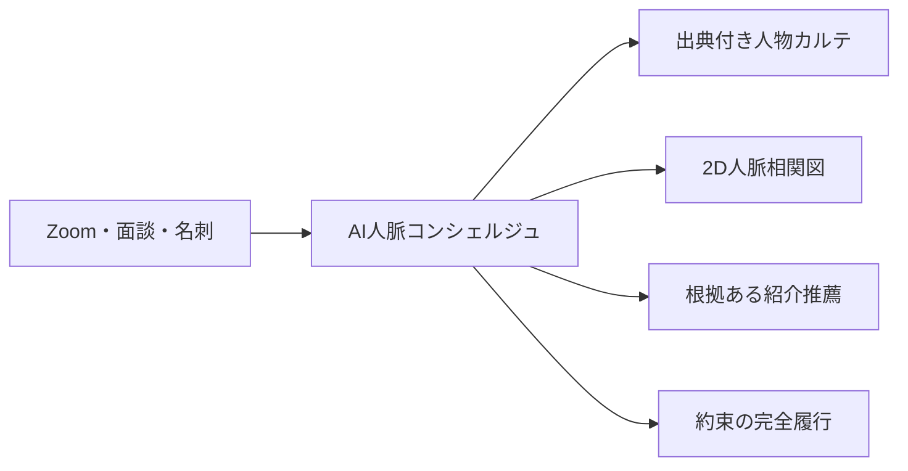
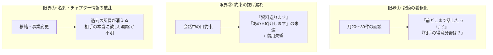
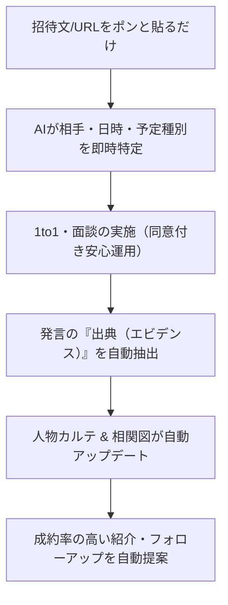
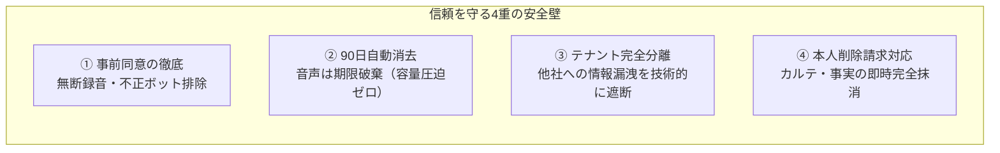
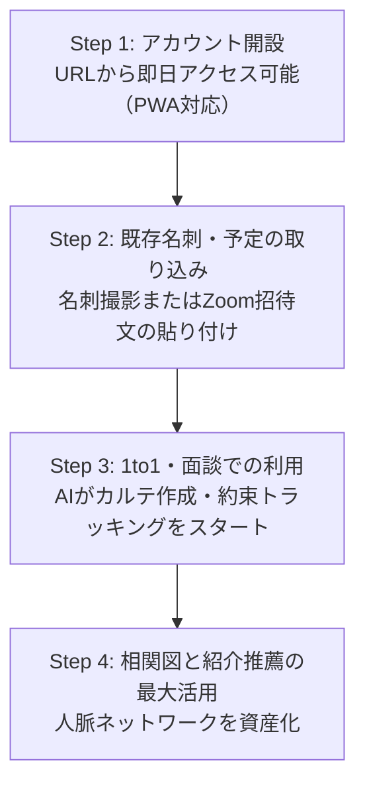

# AI人脈コンシェルジュ 営業提案資料
## — 人を忘れず、大事にし続けるための次世代AI人脈パートナー —

```
発行日: 2026年11月
対象: BNIメンバー、士業・経営者・営業リーダー、ビジネス交流会主催者
製品URL: https://ai-network-concierge.vercel.app
```

---

## 1. エグゼクティブ・サマリー（要約）

> **「単なる録音アプリでも、名刺管理ツールでもありません。」**  
> AI人脈コンシェルジュは、月30回以上の1to1や商談を行うビジネスリーダーのための、**「会話を出典つきで記憶し、約束を守り、最高の紹介を生み出す」AI専属秘書**です。



---

## 2. 多くのビジネスリーダーが直面する「3つの限界」

熱心に人脈を広げ、Givers Gain（与える者は与えられる）を実践する経営者ほど、**脳のメモリの限界**に直面しています。



### 従来のツールでは解決できなかった理由
| ツール種別 | よくある課題 |
|---|---|
| **名刺管理アプリ** | 会社名と役職はわかるが、「何を話したか」「誰を求めているか」が残らない |
| **自動議事録AI** | テキストが長大に溜まるだけで、過去の会話と紐づいた「人物カルテ」にならない |
| **一般的なSFA/CRM** | 入力作業が膨大で忙しい経営者には続かない。プライベートな信頼関係を管理できない |

---

## 3. 本製品のコアバリュー: 「信頼を資産に変える」



---

## 4. 圧倒的成果を生み出す「キラー機能」

### ① 案内文・URL丸ごと貼り付けで「3秒予定登録」
LINEやメールで届いたZoomの招待文をそのままアプリに貼り付けるだけ。
AIが**日時・URL・相手の名前・面談種別（1to1/商談/交流会）を自動判定**。重複登録も防止します。

### ② 【コア強み】文字起こし要約 × 潜在親和性（シナジー）発掘AIエンジン
60分の会話を「30秒のエグゼクティブ要約」と「約束タスク」に圧縮するだけでなく、**人脈ネットワーク全体を横断し、双方の潜在的な親和性を自動検出**します。
- **30秒要約 & アクション抽出**: 面談終了直後に決定事項、次回約束、相手が求めている顧客ターゲットを構造化。
- **潜在親和性の自動検出（シナジーマッチング 90%+）**: 例「町家風カフェを出店したい飲食店オーナー」×「古民家再生・耐震リノベーション工務店」のように、会話内の潜在ニーズと他会員の強みをAIが自動で引き合わせ。
- **紹介状ドラフト自動作成**: 双方にとって断る理由のない、失礼のない紹介文下書きをワンタップで出力。

### ③ 発言の「出典」を保持する人物カルテ
「補助金に強い」「京都と滋賀が対応エリア」「娘さんが同じ大学」など、**いつ誰が発言した事実なのか**をエビデンス付きで蓄積。3回目の面談前でも「前回お話しされていた〇〇の件ですが」と自然に会話をスタートできます。

### ④ 2Dインタラクティブ人脈相関図
登録された人脈同士のつながりを直感的なビジュアルで可視化。
- **確認済み実関係モード**: 実際に面談や名刺交換をした確実な関係のみを表示。
- **AI推薦関係モード**: 「店舗改装のニーズ」×「古民家リノベーション工務店」など、ビジネスシナジーのある潜在的な結線をAIが提案。

### ⑤ 複数事業・BNI移籍履歴の永続保持
「本業の税理士」「飲食チェーン経営」「京都東チャプターから新チャプターへの移籍」など、1人が複数の顔を持つ場合も過去の履歴を消すことなく完全保持します。

---

## 5. 安全性・プライバシー・コンプライアンス（経営基準）

ビジネス人脈において、**信用毀損は最大の致命傷**です。AI人脈コンシェルジュは業界最高水準のプライバシー設計を貫いています。



- **外部AIへの学習流用なし**: 入力されたデータがAIモデルの再学習に使用されることはありません。
- **Default Private**: 家族構成やプライベートな話題は自動で「非公開」タグが付与され、紹介文などに混入しません。

---

## 6. 導入前後のBefore / After

### 毎月30回 1to1を行う経営者 Aさんの1日

| シーン | 従来のやり方 (Before) | AI人脈コンシェルジュ導入後 (After) |
|---|---|---|
| **面談の10分前** | 過去のLINEやメモを必死に検索。結局見つからず「初めまして感」でスタート | カルテをワンタップ。**「前回の要点・相手の現在の強み・求めている顧客」**が1分で頭に入る |
| **面談中** | メモをとることに必死で、相手の表情や本音に集中できない | アイコンタクトに集中。会話の本質的なビジネスシナジーに時間を使える |
| **面談直後** | 「あの人を紹介しますね！」と言ったきり、日々の忙しさで忘れてしまう | AIが**約束事項（アクションアイテム）と紹介状ドラフト**を自動提示。3分でフォロー完了 |
| **週末の人脈整理** | 名刺の山が溜まり、誰が誰だか思い出せず罪悪感 | **自動で相関図とカルテが完成**。誰に誰を繋ぐべきかが一目瞭然 |

---

## 7. 費用対効果（ROI）シミュレーション

```
【標準プラン想定】
月額: 4,980円 (税込)
```

### 時間削減と売上創出の試算
- **面談準備・メモ整理の時間削減**:  
  1面談あたり15分削減 × 月30回 ＝ **月間7.5時間の時間創出**  
  （経営者の時給5,000円換算で **月額37,500円相当の価値**）
- **約束の履行による信頼と成約の増加**:  
  忘れられていた紹介やフォローアップが確実に実行されることで、年間わずか**1件でも新規紹介・成約が生まれれば、年間利用料（約6万円）は一瞬で回収**されます。

$$\text{ROI} = \frac{\text{創出価値（時間削減＋紹介成約）}}{\text{年間コスト 59,760円}} \geqq 600\%$$

---

## 8. 導入ステップ（最短当日利用可能）



---

## 9. よくあるご質問（FAQ）

**Q: スマホのアプリストア（App Store / Google Play）からダウンロードする必要がありますか？**  
**A:** いいえ、インストールの面倒な審査待ちが不要な最新のPWA（Webアプリ）技術を採用しています。SafariやChromeから「ホーム画面に追加」するだけで、iPhoneでもAndroidでもネイティブアプリ同様の快適さで即日ご利用いただけます。

**Q: Zoom以外の対面やGoogle Meetでの面談でも使えますか？**  
**A:** はい、対面での面談はスマホの録音機能や音声メモから取り込み可能で、Google Meetや通常の電話メモにも完全対応しています。

**Q: 相手に録音がバレて不審に思われませんか？**  
**A:** 本システムは「相手を大切にし、交わした約束を確実に果たすための同意取得」を前提に設計されています。無理に隠すのではなく、信頼関係を深めるための誠実なツールとしてご活用いただけます。

---

## 10. お問い合わせ・デモのご案内

実機デモ画面および無料トライアルのご相談は、下記よりお気軽にお問い合わせください。

- **サービス本番URL**: [https://ai-network-concierge.vercel.app](https://ai-network-concierge.vercel.app)
- **開発・運営**: AI人脈コンシェルジュ プロジェクトチーム
- **対応環境**: iPhone / Android / Mac / Windows PC 全デバイス対応
